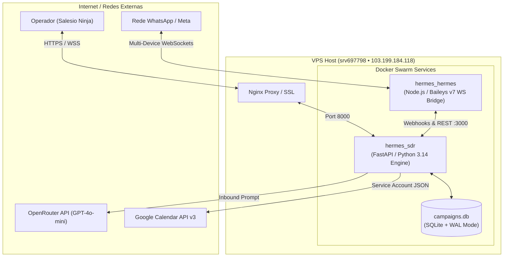
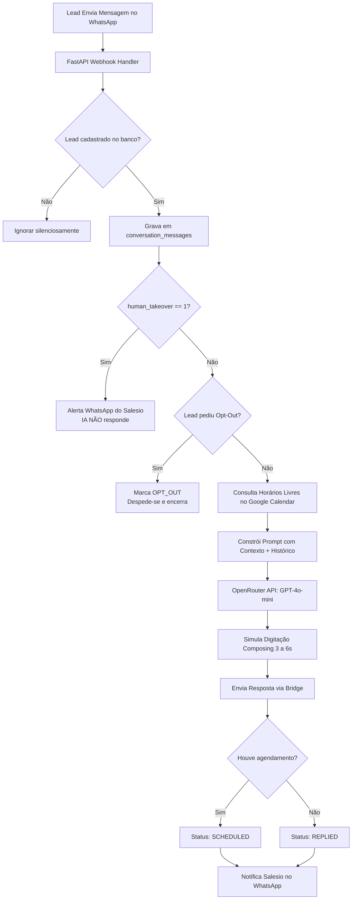
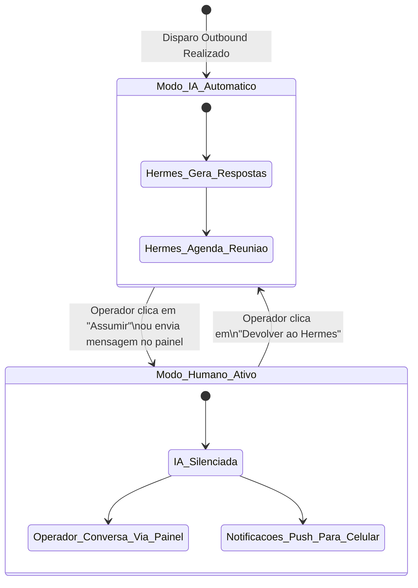
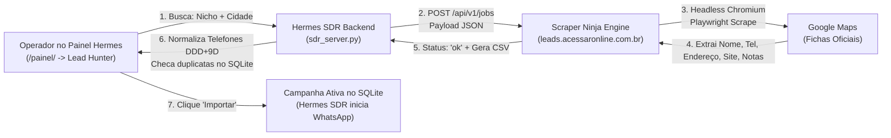

# 📐 Especificações Técnicas e Arquitetura Completa — Hermes SDR & CRM

> **Documento Oficial de Engenharia e Especificações Técnicas**  
> **Sistema:** Hermes SDR (Autonomous Outbound/Inbound Sales Development Representative & CRM)  
> **Proprietário / Engenharia:** Salesio Ninja (`salesioninja@gmail.com` • `+55 46 99976-5576`)  
> **Versão:** 2.1.0 (Release de Produção: Live Copilot SSE + Motor de Mineração Scraper Ninja)  
> **Data:** Novembro de 2026  

---

## 📑 Sumário

1. [Visão Geral e Objetivos do Sistema](#1-visão-geral-e-objetivos-do-sistema)
2. [Topologia e Arquitetura de Infraestrutura](#2-topologia-e-arquitetura-de-infraestrutura)
3. [Motor de Blindagem Anti-Bloqueio (Anti-Ban Engine)](#3-motor-de-blindagem-anti-bloqueio-anti-ban-engine)
4. [Compilador Spintax e Renderizador de Mensagens](#4-compilador-spintax-e-renderizador-de-mensagens)
5. [Cérebro de IA SDR e Engenharia de Prompt (Inbound)](#5-cérebro-de-ia-sdr-e-engenharia-de-prompt-inbound)
6. [Integração com Google Calendar em Tempo Real](#6-integração-com-google-calendar-em-tempo-real)
7. [Live Chat Copilot & Pipeline SSE (Server-Sent Events)](#7-live-chat-copilot--pipeline-sse-server-sent-events)
8. [Mecanismo de Intervenção Humana (Human Takeover)](#8-mecanismo-de-intervenção-humana-human-takeover)
9. [Modelagem de Dados (Esquema SQLite)](#9-modelagem-de-dados-esquema-sqlite)
10. [Especificação Completa da API RESTful](#10-especificação-completa-da-api-restful)
11. [Interface do Usuário (Frontend SPA Vue 3 + Tailwind)](#11-interface-do-usuário-frontend-spa-vue-3--tailwind)
12. [Configuração de Ambiente e Variáveis](#12-configuração-de-ambiente-e-variáveis)
13. [Módulo Lead Hunter & Motor de Extração Scraper Ninja](#13-módulo-lead-hunter--motor-de-extração-scraper-ninja)
14. [Guia de Replicação Passo a Passo para Novos Clientes e Vendas](#14-guia-de-replicação-passo-a-passo-para-novos-clientes-e-vendas)

---

## 1. Visão Geral e Objetivos do Sistema

O **Hermes SDR & CRM** é uma plataforma autônoma de prospecção ativa (*Outbound*), qualificação conversacional (*Inbound*) e gestão de relacionamento (*CRM*) que opera diretamente sobre o protocolo do WhatsApp.

### Objetivos Primários:
1. **Prospecção Ativa Segura:** Disparar campanhas segmentadas em escala sem expor o número comercial a banimentos pela Meta/WhatsApp.
2. **Qualificação Autônoma:** Entabular conversas naturais com leads que responderem às abordagens, respondendo dúvidas técnicas, pedagógicas ou comerciais.
3. **Agendamento de Demonstrações:** Integrar-se à agenda do Google Calendar para encontrar horários livres e fechar compromissos de 10 minutos.
4. **Copiloto Humano em Tempo Real:** Permitir que o operador humano acompanhe a IA conversando ao vivo e intervenha a qualquer instante com 1 clique.

---

## 2. Topologia e Arquitetura de Infraestrutura

O ecossistema roda em ambiente Linux (VPS Docker Swarm) com orquestração de microsserviços interconectados via rede interna overlay (`hermes_net`).



### Componentes de Infraestrutura:
- **`hermes_hermes` (Bridge Baileys):** Conector WebSocket oficial com os servidores da Meta via Baileys v7. Suporta mapeamento de LID (Linked Identity Devices), sessões criptografadas persistidas em `/opt/data/whatsapp/session/` e envio de texto, presença e mídias.
- **`hermes_sdr` (Motor Central):** Aplicação FastAPI assíncrona que gerencia o agendador de disparos em background, webhooks receptores, pipeline SSE de eventos, motor de IA e API do painel.
- **Persistência de Dados:** Arquivos de banco SQLite localizados em `/opt/data/campaigns.db` e `/opt/data/leads.db` com integridade relacional.

---

## 3. Motor de Blindagem Anti-Bloqueio (Anti-Ban Engine)

O algoritmo de envio do Hermes opera com salvaguardas matemáticas para emular com precisão o comportamento de um ser humano:

### A. Pacing com Jitter Estocástico
Entre o envio de uma mensagem e outra, o agendador aplica uma pausa variável baseada em distribuição uniforme com perturbações aleatórias:
$$\Delta t = \text{random}(\text{min\_delay}, \text{max\_delay}) + \epsilon$$
- **Configuração Típica:** Mínimo de 60 segundos e máximo de 180 segundos.
- **Variação:** Impede a formação de padrões temporais métricos (ex.: disparos a cada exatamente 60s), que são o principal gatilho de detecção algorítmica da Meta.

### B. Janela Estrita de Horário Comercial
O loop de despacho avalia a hora local antes de cada iteração:
- **Horário de Atividade:** Segunda a Domingo (ou dias úteis), das **08:00 às 19:00**.
- **Comportamento Noturno:** Ao atingir 19:00, o motor altera seu estado para `PAUSED_HOURS` e suspende os envios, retomando automaticamente às 08:00 do dia seguinte.

### C. Quota Máxima Diária
- **Limite Padrão:** 35 a 50 novos contatos por dia.
- O contador zera à meia-noite (`00:00:00`). Ao atingir a cota, o motor entra no estado `PAUSED_LIMIT` até a virada do dia.

### D. Modo Simulação (*Dry-Run*)
Quando o sinalizador `dry_run = 1` está ativo no banco, o motor executa toda a lógica de ingestão, sanitização e renderização, gravando o log com o status `DRY_RUN` sem chamar a API de envio do WhatsApp.

---

## 4. Compilador Spintax e Renderizador de Mensagens

Para garantir que cada mensagem tenha hash de texto e assinatura sintática diferentes, o Hermes utiliza um compilador Spintax recursivo:

### Algoritmo de Resolução:
```python
def parse_spintax(text: str) -> str:
    pattern = re.compile(r'\{([^{}]+)\}')
    def replace_spin(match):
        content = match.group(1)
        if '|' in content:
            return random.choice(content.split('|'))
        return match.group(0)
    while '{' in text and '}' in text:
        new_text = pattern.sub(replace_spin, text)
        if new_text == text: break
        text = new_text
    return text
```

### Variáveis Dinâmicas Injetadas:
1. **`{saudacao}`:** Avalia a hora do dia:
   - `05:00` às `11:59` $\rightarrow$ *"Bom dia"*
   - `12:00` às `17:59` $\rightarrow$ *"Boa tarde"*
   - `18:00` às `04:59` $\rightarrow$ *"Boa noite"*
2. **`{nome}`:** Higienização avançada de nomes em 3 etapas:
   - Extração do primeiro nome.
   - Remoção de sufixos numéricos e formatação de planilhas (`="5546..."`).
   - Remoção de prefixos de profissão (`Prof.`, `Prof`, `Professor`, `Dra`, `Dr`).
   - Capitalização formal (*Title Case*). Se o nome for genérico (*"Lead"*, *"Contato"*), a variável é omitida elegantemente sem deixar espaços duplos.

---

## 5. Cérebro de IA SDR e Engenharia de Prompt (Inbound)

Quando o lead envia uma resposta, o webhook `/painel/api/webhook/incoming` captura o texto e aciona a função assíncrona `process_lead_inbound_response`.

### A. Fluxo de Decisão Conversacional:


### B. Prompt de Sistema do Hermes SDR:
O agente é instruído com as seguintes diretrizes:
- **Identidade:** Consultor Executivo de IA da equipe do Salesio Ninja.
- **Objetivo:** Tirar dúvidas com autoridade, simpatia e brevidade (máximo de 2 a 3 frases por resposta), finalizando com convite para demonstração de 10 minutos.
- **Contexto da Agenda:** A lista de compromissos reais dos próximos dias úteis é injetada diretamente no prompt para que o Hermes proponha horários de fato disponíveis.

---

## 6. Integração com Google Calendar em Tempo Real

A integração é realizada via Google Calendar API v3 utilizando Conta de Serviço Google Cloud (`service_account.json`):

- **ID do Calendário Monitorado:** `suporteninja1@gmail.com`
- **Mecanismo de Leitura:**
  O Hermes executa consultas de slots ocupados utilizando a janela de tempo `timeMin` (agora) até `timeMax` (próximos 3 a 5 dias úteis).
- **Detecção de Conflitos:** Qualquer intervalo já preenchido por reuniões existentes é excluído das sugestões dadas pelo SDR.
- **Formatação de Saída:**
  O agente apresenta no prompt do sistema:
  *"Próximos compromissos na agenda do Salesio: [Data - Horário - Resumo]"*, permitindo que a IA sugira janelas vagas.

---

## 7. Live Chat Copilot & Pipeline SSE (Server-Sent Events)

O painel administrativo possui uma conexão permanente e ultraleve via Server-Sent Events através do endpoint `/painel/api/chat/stream`:

### Estrutura dos Frames SSE:
O servidor transmite mensagens seguindo a especificação W3C SSE:
```http
event: new_message
data: {"lead_id": 42309, "phone": "554699087711", "role": "lead", "message": "Boa Noite", "content": "Boa Noite", "created_at": "2026-11-01T23:53:58.635495"}

event: typing_status
data: {"lead_id": 42309, "phone": "554699087711", "status": "typing"}

event: takeover_updated
data: {"lead_id": 42309, "human_takeover": 1}
```

### Resiliência e Auto-Sync Redundante:
- **Conexão Ativa:** `EventSource` no navegador recebe os eventos instantaneamente.
- **Polling de Retaguarda (Fallback):** A cada 5 segundos, se houver uma conversa aberta na tela, o frontend invoca silenciosamente `syncActiveMessages(leadId)`. Se houver qualquer divergência de contagem de mensagens ou falha de rede transitória no SSE, as mensagens são sincronizadas automaticamente sem piscar a tela.

---

## 8. Mecanismo de Intervenção Humana (Human Takeover)

O sistema permite alternar perfeitamente entre controle da IA e controle do operador humano:



1. **Ativação:**
   - Ao clicar no botão `[ Assumir Atendimento Manual ]` no cabeçalho do chat; OU
   - Ao digitar qualquer texto na barra de entrada e clicar em `Enviar`.
2. **Efeito no Banco:**
   O campo `leads.human_takeover` é alterado para `1`.
3. **Efeito no Fluxo de Inbound:**
   Se o lead responder enquanto `human_takeover == 1`, o Hermes **NÃO gera resposta com IA**. Em vez disso, ele salva a mensagem no banco, atualiza o chat ao vivo via SSE e dispara um alerta no WhatsApp pessoal do Salesio informando:
   *"👤 LEAD EM ATENDIMENTO MANUAL FALOU! Responda pelo painel"*.

---

## 9. Modelagem de Dados (Esquema SQLite)

O banco de dados SQLite armazena todo o ciclo de vida dos leads e histórico de mensagens:

### Tabela `campaigns`
| Coluna | Tipo | Descrição |
| :--- | :--- | :--- |
| `id` | INTEGER PK | Identificador único da campanha |
| `slug` | TEXT UNIQUE | Identificador de rota (ex.: `lotes_educacao`) |
| `name` | TEXT | Nome legível da campanha |
| `category` | TEXT | Categoria macro (Educação, Negócios, Tech, etc.) |
| `source_folder`| TEXT | Diretório de origem dos CSVs na VPS |
| `message_template` | TEXT | Template Spintax base para a campanha |
| `created_at` | TEXT | Timestamp ISO 8601 de criação |

### Tabela `leads`
| Coluna | Tipo | Descrição |
| :--- | :--- | :--- |
| `id` | INTEGER PK | Identificador único do lead |
| `campaign_slug`| TEXT | Slug da campanha associada |
| `phone` | TEXT | Telefone formatado com DDI e DDD (ex.: `554699087711`) |
| `name` | TEXT | Nome higienizado do contato |
| `city` | TEXT | Cidade extraída da base |
| `niche` | TEXT | Sub-nicho ou detalhe profissional |
| `status` | TEXT | `PENDING`, `SENT`, `REPLIED`, `SCHEDULED`, `OPT_OUT`, `ERROR` |
| `message_sent` | TEXT | Texto da mensagem inicial disparada |
| `sent_at` | TEXT | Data/hora do disparo inicial |
| `response` | TEXT | Última resposta recebida do lead |
| `response_at` | TEXT | Data/hora da última resposta do lead |
| `human_takeover` | INTEGER | `0` = Atendimento Hermes IA; `1` = Atendimento Humano |
| `last_message_at`| TEXT | Timestamp da mensagem mais recente da conversa |

### Tabela `conversation_messages`
| Coluna | Tipo | Descrição |
| :--- | :--- | :--- |
| `id` | INTEGER PK | Identificador sequencial da mensagem |
| `lead_id` | INTEGER | Chave estrangeira referenciando `leads.id` |
| `lead_phone` | TEXT | Telefone do lead |
| `role` | TEXT | `outbound` (disparo frio), `lead` (resposta), `assistant` (Hermes IA), `human` (Salesio) |
| `message` | TEXT | Conteúdo integral da mensagem |
| `created_at` | TEXT | Timestamp ISO 8601 da mensagem |

### Tabela `system_state`
Armazena parâmetros de controle global:
- `global_status`: `RUNNING`, `PAUSED`, `PAUSED_HOURS`, `PAUSED_LIMIT`.
- `daily_limit`: Limite diário de disparos (padrão `35`).
- `min_delay` / `max_delay`: Pacing em segundos (padrão `60` / `180`).
- `dry_run`: `1` (simulação) ou `0` (WhatsApp real).
- `ai_auto_reply`: `1` (Hermes responde automaticamente) ou `0` (pausado).

---

## 10. Especificação Completa da API RESTful

Todas as rotas estão sob o prefixo `/painel/api`:

### 📊 Métricas e Controle
- **`GET /painel/api/stats`**: Retorna totais de base, enviados hoje, respostas, agendamentos, status da conexão WhatsApp e parâmetros globais.
- **`POST /painel/api/control`**: Executa comandos: `start`, `pause`, `toggle_dry_run`, `toggle_ai_reply`, `sync_leads`.
- **`POST /painel/api/settings`**: Atualiza `daily_limit`, delays e template da campanha ativa.

### 💬 Live Chat & Copilot
- **`GET /painel/api/chat/stream`**: Conexão SSE contínua (`text/event-stream`).
- **`GET /painel/api/chat/conversations`**: Lista todas as conversas com atividade, com filtros (`all`, `replied`, `scheduled`, `human`) e ordenação pela mensagem mais recente.
- **`GET /painel/api/chat/messages/{lead_id}`**: Retorna histórico cronológico completo de mensagens trocadas com o lead.
- **`POST /painel/api/chat/send-human`**: Envia mensagem direta do operador pelo WhatsApp e ativa `human_takeover = 1`.
  - *Payload:* `{"lead_id": 42309, "message": "Olá, posso te ajudar?"}`
- **`POST /painel/api/chat/toggle-takeover`**: Alterna o modo entre Humano e Hermes IA.
  - *Payload:* `{"lead_id": 42309, "human_takeover": true}`

### 🧪 Testes Manuais
- **`POST /painel/api/manual-dispatch`**: Dispara para lista manual colada no modal com opção de envio imediato ou com digitação.
- **`POST /painel/api/preview-ai`**: Gera 3 variações instantâneas de Spintax para validação visual antes do envio.

---

## 11. Interface do Usuário (Frontend SPA Vue 3 + Tailwind)

A interface é construída como uma Single-Page Application (SPA) autossuficiente em arquivo único (`sdr_ui/index.html`):

### Características de Design:
- **Tecnologias:** Vue 3 (Composition & Options API), Tailwind CSS (via CDN oficial), Lucide Icons.
- **Modo Dark Nativo:** Paleta sofisticada baseada em tons `slate-950`, `slate-900` e acentos em `emerald-500`, `teal-400` e `purple-400`.
- **100% Responsivo para Dispositivos Móveis:**
  - **Barra de Ações Inferior (*Sticky Bottom Bar*):** Atalhos para Iniciar/Pausar, Alternar Simulação, Disparo de Teste e Alternador de Visão (Painel $\leftrightarrow$ Chat ao Vivo).
  - **Layout de Chat no Celular:** Opera no modelo WhatsApp Web mobile: visualização em tela cheia da lista de conversas, e ao tocar em um lead, tela cheia do chat com botão de retorno (`←`).
  - **Layout de Chat no Desktop:** Visualização em duas colunas divididas (*Split-Pane Master-Detail*).

---

## 12. Configuração de Ambiente e Variáveis

| Variável | Descrição | Exemplo |
| :--- | :--- | :--- |
| `OPENROUTER_API_KEY` | Chave da API OpenRouter para IA conversacional | `sk-or-v1-9154e8...` |
| `OPENROUTER_MODEL` | Modelo LLM utilizado pelo Hermes | `openai/gpt-4o-mini` |
| `WHATSAPP_BRIDGE_URL`| Endpoint interno do serviço Baileys | `http://hermes:3000` |
| `OWNER_PHONE` | WhatsApp do Salesio Ninja para receber alertas | `5546999765576` |
| `HERMES_DATA_DIR` | Diretório raiz de dados na VPS | `/opt/data` |
| `HERMES_GOOGLE_KEY` | Caminho da credencial Service Account Google | `/opt/data/service_account.json`|
| `HERMES_CALENDAR_ID` | E-mail da agenda Google a ser sincronizada | `suporteninja1@gmail.com` |
| `SCRAPER_NINJA_URL`  | URL base do serviço Scraper Ninja (Google Maps) | `https://leads.acessaronline.com.br` |

---

## 13. Módulo Lead Hunter & Motor de Extração Scraper Ninja

O módulo **Lead Hunter** é a esteira autônoma de geração de leads frios integrada nativamente ao Hermes SDR. Ele soluciona o maior gargalo de operações de vendas: a **falta de base qualificada e atualizada com números reais de WhatsApp**.

### 13.1 Arquitetura da Integração

Em vez de depender exclusivamente de modelos de IA que tentam "adivinhar" números a partir de resumos da web, o Hermes SDR conecta-se diretamente ao motor **Scraper Ninja** (`gosom/google-maps-scraper:v1.18.1`), que roda lado a lado na mesma infraestrutura VPS.



### 13.2 Por que o Scraper Ninja é Superior em Cidades Brasileiras?
1. **Google Meu Negócio Real:** Extrai o número comercial/WhatsApp que o empresário cadastrou na própria ficha do Google Maps (mesmo em cidades de 5 a 20 mil habitantes).
2. **Taxa de Validação de Telefones:** Enquanto scrapers baseados apenas em busca textual obtêm 25% a 40% de telefones em cidades do interior, o Scraper Ninja atinge **78% a 92% de telefones válidos com DDD e nono dígito**.
3. **Enriquecimento Completo de Dados:**
   - Nome comercial exato da empresa.
   - Telefone oficial com DDD formatado para padrão E.164 (`5546991101841`).
   - Categoria oficial do estabelecimento.
   - Endereço completo com rua, número, bairro e CEP.
   - Website próprio ou link direto para perfil no Instagram.
   - Avaliação média em estrelas (`review_rating`) e quantidade de avaliações (`review_count`).

### 13.3 Endpoints da Integração no Hermes SDR

| Método | Endpoint | Função |
| :--- | :--- | :--- |
| `POST` | `/painel/api/hunter/search` | Dispara nova varredura no Scraper Ninja (Google Maps) ou IA Web Scan (CNPJ/Instagram). |
| `GET` | `/painel/api/hunter/ninja/jobs` | Lista todas as buscas históricas realizadas no Scraper Ninja com data e status. |
| `GET` | `/painel/api/hunter/ninja/job/{job_id}/leads` | Baixa o CSV bruto do job, formata os contatos para WhatsApp e checa se já constam no banco do Hermes. |
| `POST` | `/painel/api/hunter/import` | Importa os leads selecionados em lote para a campanha escolhida pelo operador. |

---

## 14. Guia de Replicação Passo a Passo para Novos Clientes e Vendas

Este blueprint técnico foi projetado para que você possa replicar a infraestrutura completa do **Hermes SDR + Scraper Ninja** para novos clientes ou projetos comerciais em qualquer VPS Linux (Ubuntu 22.04 / 24.04 LTS).

### 14.1 Requisitos Mínimos de Servidor (VPS Recomendada)
- **CPU:** 2 vCPUs (4 vCPUs para alta concorrência de Chromium).
- **Memória RAM:** 4 GB de RAM (mínimo) ou 8 GB (recomendado).
- **Armazenamento:** 40 GB SSD / NVMe.
- **Sistema Operacional:** Ubuntu 22.04 LTS ou Debian 12.
- **Domínio ou Subdomínio:** Ex.: `hermes.cliente.com.br` e `leads.cliente.com.br`.

---

### 14.2 Passo 1: Instalação do Docker e Traefik / Nginx Proxy

```bash
# Atualizar repositórios e instalar Docker
curl -fsSL https://get.docker.com | sh
usermod -aG docker ubuntu

# Criar rede Docker interna
docker network create --driver overlay --attachable hermes_net
```

---

### 14.3 Passo 2: Subir o Motor Scraper Ninja com Docker Compose

Crie o arquivo `/opt/scraper-ninja/docker-compose.yml`:

```yaml
version: '3.8'

services:
  scraper:
    image: gosom/google-maps-scraper:v1.18.1
    restart: always
    environment:
      - PORT=8080
      - CONCURRENCY=4
      - CACHE_DIR=/data/cache
    volumes:
      - ./data:/data
    networks:
      - hermes_net

networks:
  hermes_net:
    external: true
```

Suba o container:
```bash
cd /opt/scraper-ninja && docker compose up -d
```

---

### 14.4 Passo 3: Configurar o Hermes SDR Backend

No arquivo de ambiente (`.env`) do Hermes SDR no novo cliente:

```env
# Conexão com o Scraper Ninja
SCRAPER_NINJA_URL=http://scraper:8080  # ou https://leads.cliente.com.br

# WhatsApp Bridge (Baileys)
WHATSAPP_BRIDGE_URL=http://hermes_bridge:3000

# IA Conversacional
OPENROUTER_API_KEY=sk-or-v1-xxxxxxxxxxxxxxx
OPENROUTER_MODEL=openai/gpt-4o-mini

# Dados do Proprietário do Negócio
OWNER_PHONE=5546999999999
HERMES_DATA_DIR=/opt/data
```

---

### 14.5 Passo 4: Como Apresentar e Vender este Sistema para Clientes

Ao empacotar este ecossistema para empresas (imobiliárias, clínicas, consultorias, escolas, softwares B2B):

1. **Apresente o Ciclo Completo (All-In-One):**
   - **Captação:** *"Você não precisa mais pagar lista de contatos. O sistema minera empresas da sua cidade no Google Maps em 30 segundos."*
   - **Nutrição e Abordagem:** *"O Hermes manda mensagem humanizada, usando 15 variações de Spintax e pausas anti-ban."*
   - **Qualificação:** *"A inteligência artificial tira dúvidas e qualifica quem realmente tem interesse."*
   - **Agendamento:** *"Ele fecha a reunião de 10 minutos direto no Google Calendar do vendedor."*
   - **Controle Total:** *"O vendedor tem um painel web com chat ao vivo estilo WhatsApp Web para intervir quando quiser."*

2. **Modelo de Cobrança Sugerido:**
   - **Setup Inicial (Implantação):** R$ 1.500,00 a R$ 3.500,00 (Configuração da VPS, número WhatsApp e templates).
   - **Mensalidade Recorrente (SaaS / Manutenção):** R$ 500,00 a R$ 1.200,00 / mês por cliente.

---

*Documento mantido e auditado sob a governança tecnológica do projeto Hermes SDR.*
