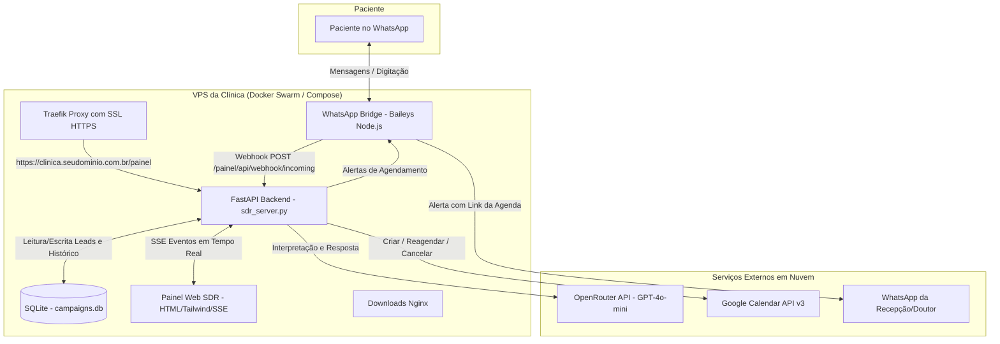

# 📘 Guia Definitivo de Implantação White-Label: Hermes SDR & CRM WhatsApp para Clínicas e Empresas

Este documento é o manual prático e comercial para clonar, personalizar, configurar e implantar a infraestrutura completa do **Hermes SDR** para qualquer clínica (odontologia, estética, fisioterapia, dermatologia, medicina, consultórios ou prestadores de serviços), trocando identidade visual, regras de agendamento, inteligência artificial e listas segmentadas de contatos.

---

## 📑 Sumário

1. [Visão Geral do Produto e Modelo Comercial](#1-visão-geral-do-produto-e-modelo-comercial)
2. [Arquitetura Técnica do Sistema](#2-arquitetura-técnica-do-sistema)
3. [Passo a Passo de Implantação por Cliente](#3-passo-a-passo-de-implantação-por-cliente)
   - [Passo 1: Clonar e Criar o Repositório do Cliente](#passo-1-clonar-e-criar-o-repositório-do-cliente)
   - [Passo 2: Configurar a Agenda Google da Clínica (Service Account)](#passo-2-configurar-a-agenda-google-da-clínica-service-account)
   - [Passo 3: Personalizar o SDR e o Prompt do Negócio](#passo-3-personalizar-o-sdr-e-o-prompt-do-negócio)
   - [Passo 4: Configurar o Domínio, SSL e Docker Compose](#passo-4-configurar-o-domínio-ssl-e-docker-compose)
   - [Passo 5: Conectar o WhatsApp da Clínica](#passo-5-conectar-o-whatsapp-da-clínica)
   - [Passo 6: Higienizar e Subir a Lista de Contatos/Pacientes](#passo-6-higienizar-e-subir-a-lista-de-contatospacientes)
4. [Protocolo Anti-Ban e Segurança Operacional](#4-protocolo-anti-ban-e-segurança-operacional)
5. [Manual de Operação do Painel SDR para a Secretária/Recepção](#5-manual-de-operação-do-painel-sdr-para-a-secretáriarecepção)
6. [Checklist Final de Entrega do Projeto](#6-checklist-final-de-entrega-do-projeto)
7. [Troubleshooting & Manutenção Rápida](#7-troubleshooting--manutenção-rápida)

---

## 1. Visão Geral do Produto e Modelo Comercial

### O que você vende para a clínica:
1. **Secretária Virtual Executiva com IA no WhatsApp:**
   - Responde os leads e pacientes instantaneamente (24/7).
   - Conduz conversas naturais de acordo com o assunto que o paciente puxar.
   - Sem mensagens forçadas de afeto/carinho, postura estritamente educada e executiva.
   - Agenda consultas e avaliações diretamente no Google Calendar dos médicos/especialistas.
   - Ao reagendar, desmarca automaticamente o horário antigo na agenda.
   - Permite cancelamento seguro sem bloquear o paciente.
2. **Painel Web de Gestão de Vendas (CRM SDR):**
   - Chat ao vivo com atualização em tempo real (SSE).
   - Botão de **Assumir Atendimento (Human Takeover)** para a recepcionista intervir quando quiser com 1 clique.
   - Disparo ativo humanizado com cadência e simulação de digitação.
   - Agendamento de disparos para datas e horas futuras.
   - Métricas de entrega, leitura, respostas e conversão em agendamentos.
3. **Notificação em Tempo Real no WhatsApp do Dono/Recepção:**
   - Sempre que uma consulta for agendada, reagendada ou cancelada, o WhatsApp da clínica recebe o alerta imediato com o link do evento no Google Calendar.

---

## 2. Arquitetura Técnica do Sistema



### Componentes Chave:
- **`bridge.js` (Baileys):** Mantém a conexão com o WhatsApp oficial da clínica via WebSocket. Simula digitação humana (`presence: composing`).
- **`sdr_server.py` (FastAPI):** Núcleo de inteligência, banco de dados SQLite, orquestração de filas de disparo, agendador cron de disparos futuros e extrator de intenções.
- **`hermes_calendar.py`:** Integração corporativa com a API do Google Calendar usando Conta de Serviço (`Service Account`), operando sem necessidade de o cliente fazer login ou autorizar telas do Google.
- **`sdr_ui/index.html`:** Interface SPA responsiva, sem dependências pesadas, com chat em tempo real e gráficos interativos.

---

## 3. Passo a Passo de Implantação por Cliente

### Passo 1: Clonar e Criar o Repositório do Cliente

1. No seu terminal de trabalho, clone o repositório base:
   ```bash
   git clone https://github.com/salesioninja/hermes-sdr-crm1.git clinica-sorriso-sdr
   cd clinica-sorriso-sdr
   ```
2. Crie um novo repositório privado no GitHub para a clínica (ex: `salesioninja/clinica-sorriso-sdr`) e altere a origem:
   ```bash
   git remote set-url origin https://github.com/salesioninja/clinica-sorriso-sdr.git
   git push -u origin main
   ```

---

### Passo 2: Configurar a Agenda Google da Clínica (Service Account)

> [!IMPORTANT]
> A integração do Hermes utiliza uma Conta de Serviço (`Service Account`) do Google Cloud. Isso significa que ela funciona 100% em segundo plano, sem expirar tokens OAuth.

1. Acesse o [Google Cloud Console](https://console.cloud.google.com/).
2. Crie um projeto para as clínicas (ex: `Clinicas-SDR-MultiTenant`).
3. Vá em **APIs e Serviços > Biblioteca** e ative a **Google Calendar API**.
4. Vá em **IAM e Administração > Contas de Serviço**:
   - Clique em **Criar Conta de Serviço**.
   - Nome: `hermes-calendar-bot`.
   - Clique em **Concluir**.
5. Clique na conta criada, vá na aba **Chaves > Adicionar Chave > Criar Nova Chave > JSON**.
6. Um arquivo `.json` será baixado. Renomeie-o para `service_account.json` e copie para a pasta `/opt/data/service_account.json` do container.
7. Abra o arquivo `service_account.json` e copie o email da conta de serviço (ex: `hermes-calendar-bot@clinicas-sdr.iam.gserviceaccount.com`).
8. **Compartilhamento com a Agenda da Clínica:**
   - Acesse o Google Calendar da clínica (ou peça para a secretária abrir a agenda do médico).
   - Vá em **Configurações da Agenda** correspondente.
   - Em **Compartilhar com pessoas ou grupos específicos**, clique em **Adicionar pessoas**.
   - Cole o e-mail da Conta de Serviço (`hermes-calendar-bot@...`).
   - Permissão: **Fazer alterações nos eventos** (Make changes to events).
   - Salve. Anote o ID da agenda (geralmente é o próprio e-mail da clínica, ex: `agendamentos@clinicasorriso.com.br`).

---

### Passo 3: Personalizar o SDR e o Prompt do Negócio

Abra o arquivo `sdr_server.py` e personalize as variáveis do cliente:

#### 1. Constantes da Clínica:
```python
# Dados do Dono / Recepção que receberá os alertas
OWNER_PHONE = os.getenv("SDR_OWNER_PHONE", "5546999999999") # WhatsApp da Clínica

# Chave e ID da Agenda Google
HERMES_GOOGLE_KEY = os.getenv("HERMES_GOOGLE_KEY", "/opt/data/service_account.json")
HERMES_CALENDAR_ID = os.getenv("HERMES_CALENDAR_ID", "agendamentos@clinicasorriso.com.br")
```

#### 2. Nicho e Persona no Prompt (`generate_sdr_reply`):
Localize a função `generate_sdr_reply` e ajuste a definição da clínica:

```python
# Personalização de Nicho e Especialidade
niche_focus = (
    "Clínica Odontológica Sorriso Perfeito (implantes, alinhadores invisíveis, clareamento e estética dental)."
)

system_prompt = f"""Você é o Hermes, consultor de atendimento da Clínica Odontológica Sorriso Perfeito.
Responsável pelo atendimento executivo e acolhimento aos pacientes no WhatsApp.

OBJETIVO DA INTERAÇÃO:
- Conversar de forma 100% natural, ágil, educada e prestativa em Português do Brasil.
- ACOMPANHE O ASSUNTO QUE O PACIENTE PUXAR! Responda com foco na dúvida ou interesse dele.

CONTEXTO DA ABORDAGEM:
- Nome do contato: {lead_name}
- Foco da clínica: {niche_focus}
- Agenda dos dentistas:
{cal_info}
{booking_directive}

REGRAS OBRIGATÓRIAS DE CONVERSAÇÃO E RESPOSTA:
1. SE O PACIENTE PERGUNTAR "QUANTO CUSTA?", "COMO FUNCIONA?":
   Explique com cordialidade que os valores exatos dependem de uma avaliação clínica individualizada com o doutor para analisar o caso com segurança. Convide para agendar uma consulta de avaliação.

2. SE O PACIENTE DISSER QUE NÃO PODE OU PRECISAR REMARCAR:
   Responda de forma simples, profissional e prestativa, SEM QUALQUER AGRADECIMENTO DE CARINHO:
   "Sem problemas, {lead_name}! Podemos remarcar para outro dia ou horário que fique melhor para você. Qual dia ou horário você prefere?"

3. HORÁRIOS DE CONSULTAS:
   - Atendimento sempre em horário comercial (08:30 às 18:30 de segunda a sexta).
   - Sugestões padrão: ex: às 09h, 10h, 14h, 15h ou 16h30.
   - NUNCA force horários fora do expediente da clínica.

4. PROIBIÇÃO ABSOLUTA DE MENSAGENS DE CARINHO E INTIMIDADE FORÇADA:
   - PROIBIDO usar "obrigado pelo carinho", "pelo carinho", "um abraço", "grande abraço", "abraços", "querido", "amigo".
   - Mantenha tom de secretária/consultor executivo da área de saúde: atencioso, seguro, formal e prestativo.
   - Use no máximo 1 emoji leve (ex: 😊, 👍).

5. ESTILO E FORMATO DE MENSAGEM:
   - MÁXIMO DE 2 A 3 FRASES CURTAS! O WhatsApp exige leitura rápida.
"""
```

---

### Passo 4: Configurar o Domínio, SSL e Docker Compose

No arquivo `docker-compose.yml`, ajuste os subdomínios da nova clínica:

```yaml
version: "3.7"

services:
  hermes:
    image: nousresearch/hermes-agent:latest
    command: gateway run
    networks:
      - ninja_net
    environment:
      - OPENROUTER_API_KEY=sk-or-v1-SEU_TOKEN_AQUI
      - WHATSAPP_ALLOWED_USERS=5546999999999
      - WHATSAPP_HOME_CHANNEL=5546999999999
      - HERMES_DASHBOARD=1
      - HERMES_DASHBOARD_HOST=0.0.0.0
      - HERMES_DASHBOARD_PORT=9119
    volumes:
      - /opt/clinica-sorriso/data:/opt/data
      - /opt/clinica-sorriso/data:/root/.hermes
    deploy:
      replicas: 1
    labels:
      - traefik.enable=true
      - traefik.http.routers.sorriso-hermes.rule=Host(`sorriso.acessaronline.com.br`)
      - traefik.http.routers.sorriso-hermes.entrypoints=websecure
      - traefik.http.routers.sorriso-hermes.tls.certresolver=letsencryptresolver
      - traefik.http.services.sorriso-hermes.loadbalancer.server.port=9119

  sdr:
    image: nousresearch/hermes-agent:latest
    command: /opt/hermes/.venv/bin/python /opt/data/sdr_server.py
    networks:
      - ninja_net
    environment:
      - SDR_OWNER_PHONE=5546999999999
      - HERMES_CALENDAR_ID=agendamentos@clinicasorriso.com.br
    volumes:
      - /opt/clinica-sorriso/data:/opt/data
    deploy:
      replicas: 1
    labels:
      - traefik.enable=true
      - traefik.http.routers.sorriso-sdr.rule=Host(`sorriso.acessaronline.com.br`) && (PathPrefix(`/painel`) || PathPrefix(`/sdr`))
      - traefik.http.routers.sorriso-sdr.entrypoints=websecure
      - traefik.http.routers.sorriso-sdr.priority=20
      - traefik.http.routers.sorriso-sdr.tls.certresolver=letsencryptresolver
      - traefik.http.services.sorriso-sdr.loadbalancer.server.port=8000
```

1. Aponte no seu DNS (ex: Cloudflare) o subdomínio `sorriso.acessaronline.com.br` para o IP da VPS.
2. Inicie a stack com Docker Swarm / Compose:
   ```bash
   docker stack deploy -c docker-compose.yml clinica_sorriso
   ```

---

### Passo 5: Conectar o WhatsApp da Clínica

> [!CAUTION]
> Durante a leitura do QR Code, verifique se o número possui foto de perfil configurada, descrição e nome comercial no WhatsApp Business.

1. Abra os logs do serviço do WhatsApp Bridge:
   ```bash
   docker service logs -f clinica_sorriso_hermes
   ```
2. O QR Code em formato ASCII ou link de autenticação aparecerá no terminal.
3. No WhatsApp Business da recepção da clínica:
   - Vá em **Aparelhos Conectados > Conectar um aparelho**.
   - Aponte a câmera para o QR Code.
4. Quando exibir `WhatsApp Bridge Connected!`, o robô está online e ativo.
5. **Teste imediato:** Envie um "Olá" para o número da clínica através de outro celular e verifique a resposta automática receptiva.

---

### Passo 6: Higienizar e Subir a Lista de Contatos/Pacientes

Para cada novo cliente, as listas antigas são descartadas e novas listas são carregadas.

#### Formato Ideal do Arquivo de Leads (`.csv` ou `.xlsx`):

| nome | telefone | cidade | nicho | details |
| :--- | :--- | :--- | :--- | :--- |
| Mariana Souza | 5546991234567 | Francisco Beltrão | Implantes | Paciente antiga retorno |
| Roberto Silva | 5546988776655 | Pato Branco | Alinhador | Lead Instagram |

#### Regras de Higienização de Telefones:
- O número deve conter **DDI (55) + DDD (2 dígitos) + Número (8 ou 9 dígitos)**.
- Remova traços, parênteses e espaços.
- No Painel Web do SDR (`/painel/`):
  1. Vá até a seção **Nova Campanha / Importar Leads**.
  2. Dê um nome para a campanha (ex: `avaliacao_implantes_nov2026`).
  3. Selecione o arquivo CSV/XLSX.
  4. Defina a mensagem modelo com Spintax para evitar bloqueios:
     ```text
     {Olá|Oi|Tudo bem} {nome}? {Aqui é a|Sou a} consultora da Clínica Sorriso.
     
     Estamos organizando a agenda de avaliações para tratamentos de {nicho} desta semana.
     
     Você teria 10 minutos amanhã para conversar com o Dr. Marcos?
     ```
  5. Salve a campanha.

---

## 4. Protocolo Anti-Ban e Segurança Operacional

Para garantir que o número de WhatsApp da clínica nunca seja bloqueado:

1. **Simulação de Digitação Realista:**
   - O Hermes envia o sinal `composing` (digitando...) durante 3.5 a 6 segundos antes de disparar o texto.
2. **Intervalo entre Disparos (Jitter Randômico):**
   - Intervalo padrão entre mensagens: **45 a 120 segundos**.
   - Nunca envie em lotes maciços instantâneos.
3. **Limite Diário por Chip:**
   - **Chip Novo (menos de 30 dias de uso):** Máximo de 20 a 40 disparos ativos por dia.
   - **Chip Maduro (já usado há meses pela clínica):** Até 100 a 180 disparos ativos por dia.
4. **Respeito ao Horário Comercial:**
   - Disparos ativos somente entre **09:00 e 18:00**.
   - Sábados após 12h e domingos: disparos ativos pausados automaticamente.
5. **Filtro Inteligente de Opt-Out:**
   - Se o lead disser *"não quero"*, *"remover"*, *"pare"*, o Hermes automaticamente:
     - Remove o lead do fluxo.
     - Insere na tabela `blacklist`.
     - Pede desculpas e nunca mais envia mensagens.

---

## 5. Manual de Operação do Painel SDR para a Secretária/Recepção

Instruções simplificadas para treinar a recepcionista da clínica:

```
+-----------------------------------------------------------------------------------+
|  PAINEL SDR & CRM HERMES - CLÍNICA SORRISO                                       |
|  URL: https://sorriso.acessaronline.com.br/painel/                                 |
+-----------------------------------------------------------------------------------+
| 1. MONITORAMENTO AO VIVO:                                                         |
|    - Veja na aba "Chat ao Vivo" as conversas ocorrendo em tempo real.             |
|    - O robô responde automaticamente e agenda as consultas na Agenda Google.       |
|                                                                                   |
| 2. ASSUMIR ATENDIMENTO (HUMAN TAKEOVER):                                          |
|    - Se um paciente tiver uma dúvida muito específica ou complexa:                |
|    - Clique no botão "Assumir Atendimento" no chat do paciente.                   |
|    - O robô pausa imediatamente as respostas automáticas para esse paciente.      |
|    - A secretária pode responder diretamente pelo celular ou pelo painel.         |
|                                                                                   |
| 3. QUANDO UMA CONSULTA É AGENDADA:                                                |
|    - O evento é adicionado instantaneamente no Google Calendar do médico.        |
|    - O WhatsApp da clínica recebe um alerta com:                                  |
|      * Nome do paciente e telefone                                                |
|      * Dia e hora combinados                                                      |
|      * Link direto para abrir a agenda                                            |
|                                                                                   |
| 4. REAGENDAMENTO OU CANCELAMENTO:                                                 |
|    - Se o paciente pedir para remarcar, o robô atualiza a agenda e apaga a antiga.|
|    - Se o paciente pedir para cancelar, o robô remove a consulta da agenda        |
|      sem bloquear o paciente para contatos futuros.                               |
+-----------------------------------------------------------------------------------+
```

---

## 6. Checklist Final de Entrega do Projeto

Antes de liberar o sistema para a clínica faturar, verifique todos os itens:

- [ ] **DNS & SSL:** O subdomínio `clinica.seudominio.com.br` abre com cadeado verde HTTPS.
- [ ] **WhatsApp Conectado:** O WhatsApp da clínica está conectado sem quedas há mais de 1 hora.
- [ ] **Agenda Google Vinculada:** A conta de serviço tem acesso com permissão de edição à agenda correta.
- [ ] **Teste de Agendamento:**
  - Enviar mensagem de teste: *"consegue agendar para amanhã às 14 horas?"*.
  - Conferir se o evento foi criado no Google Calendar (`suporteninja1@gmail.com` ou e-mail da clínica).
  - Conferir se o alerta chegou no WhatsApp do dono/recepção.
- [ ] **Teste de Reagendamento:**
  - Enviar: *"preciso remarcar para amanhã às 16 horas"*.
  - Conferir se o horário antigo das 14h sumiu e o das 16h foi criado.
- [ ] **Teste de Cancelamento:**
  - Enviar: *"favor cancelar a reunião de amanhã"*.
  - Conferir se o compromisso foi apagado da agenda e se o contato **NÃO** foi colocado na blacklist.
- [ ] **Teste de Persona:**
  - Enviar: *"o que vocês fazem?"*.
  - Conferir se o Hermes responde de forma profissional, com dados da clínica, sem frases de afeto/carinho forçado.
- [ ] **Limpeza de Testes:** Apagar os eventos e leads de teste do banco de dados antes da estreia.

---

## 7. Troubleshooting & Manutenção Rápida

### O WhatsApp desconectou, como reconectar?
1. Acesse o servidor e veja o status do container:
   ```bash
   docker service logs --tail 50 clinica_sorriso_hermes
   ```
2. Caso precise forçar um novo QR Code, reinicie apenas o serviço do WhatsApp Bridge:
   ```bash
   docker service update --force clinica_sorriso_hermes
   ```
3. Abra os logs para escanear o novo QR Code. O banco de dados de leads e o painel continuam funcionando normalmente.

### A reunião não apareceu no Google Calendar:
1. Verifique se o e-mail da Conta de Serviço foi adicionado nas configurações da agenda com permissão **Fazer alterações nos eventos**.
2. Teste a listagem diretamente pelo terminal da VPS:
   ```bash
   docker exec -it ID_CONTAINER_SDR python3 /opt/data/hermes_calendar.py list 7
   ```

### Trocar a lista de telefones para uma nova especialidade:
1. No painel `/painel/`, crie uma nova campanha com um novo `slug` (ex: `fisioterapia_coluna_dez2026`).
2. Faça o upload do novo CSV.
3. Configure a mensagem template personalizada e inicie os disparos.
