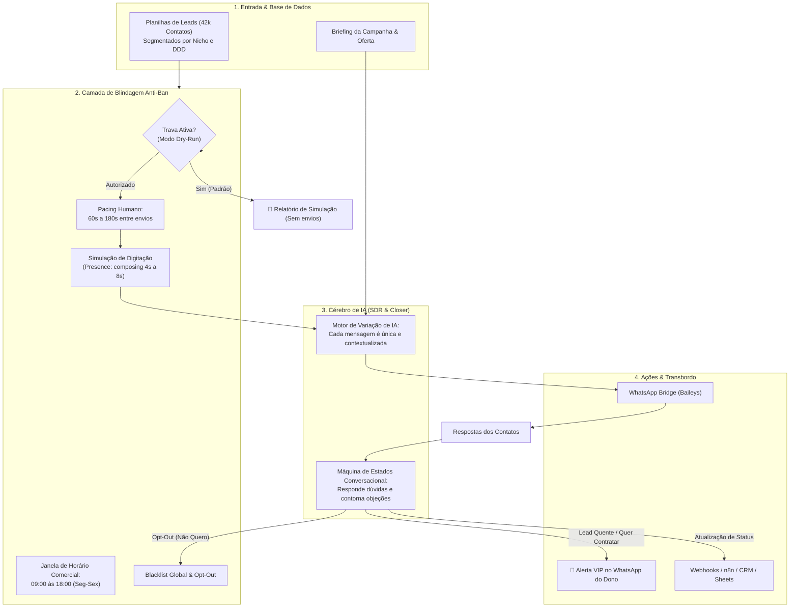
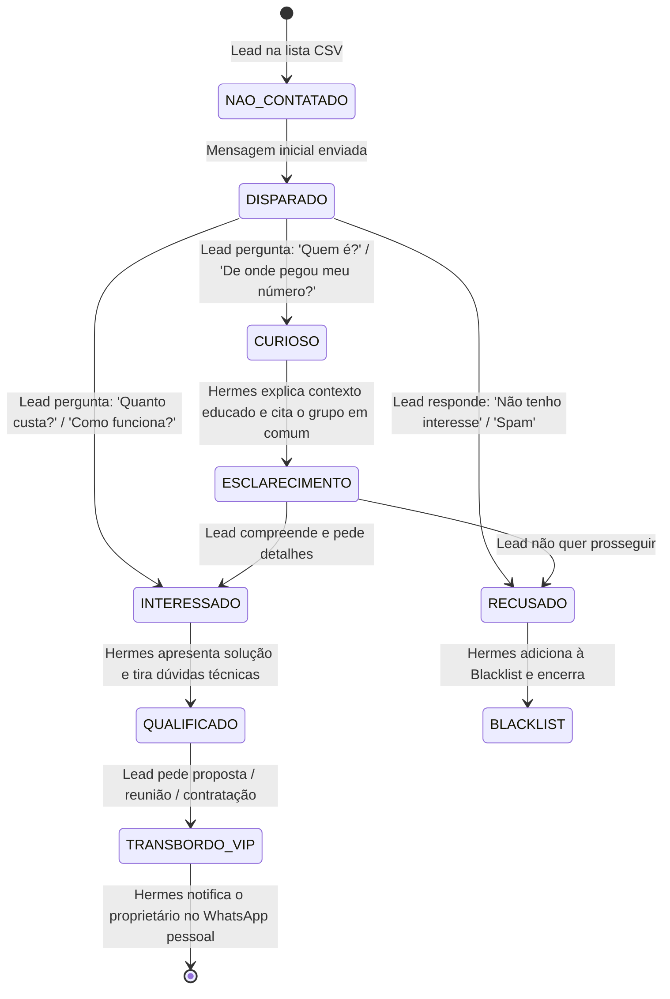

# 🤖 WhatsApp Outbound SDR & Conversational AI Closer

Esta skill transforma o **Hermes Agent** em um **SDR (Sales Development Representative) e Closer Conversacional com Inteligência Artificial**, capaz de realizar prospecção ativa humanizada, qualificar respostas em tempo real e transferir leads quentes para o proprietário sem risco de banimento de chip.

> [!CAUTION]
> ### 🛑 PROTOCOLO DE TRAVA DE SEGURANÇA (DRY-RUN ATIVO)
> Por padrão, esta skill opera em **MODO SIMULAÇÃO (Dry-Run)**. Nenhuma mensagem é disparada para contatos reais sem aprovação explícita e autorização deliberada do proprietário (`confirmar_disparo: true`).

---

## 🏗️ 1. Arquitetura do Sistema



---

## 🛡️ 2. As 5 Regras de Ouro Anti-Banimento

Disparar mensagens frias no WhatsApp exige controle científico. A skill implementa as seguintes travas obrigatórias:

| Regra | Parâmetro | Motivo Técnico |
| :--- | :--- | :--- |
| **1. Teto Diário Seguro** | Máximo **30 a 50 msgs/dia** (chip pessoal) | O algoritmo da Meta detecta picos anômalos de novas conversas iniciadas por dia. |
| **2. Pacing Aleatório Humano** | Intervalo de **60 a 180 segundos** | Evita a assinatura temporal de disparador automatizado. |
| **3. Presença de Digitação** | `presence: composing` por 4 a 8s | Faz aparecer *"digitando..."* no aplicativo do destinatário antes do envio. |
| **4. Motor de IA Anti-Spintax** | 0% de mensagens idênticas | A IA reescreve a saudação, estrutura e tom mantendo apenas o núcleo da proposta. |
| **5. Respeito Instantâneo ao Opt-Out** | Inclusão imediata em `blacklist.json` | Se a pessoa disser *"não tenho interesse"*, *"quem é?"* ou *"pare"*, o robô pede desculpas e nunca mais manda mensagem. |

---

## 🔄 3. Máquina de Estados Conversacional (AI Closer)

Quando o lead responde à primeira mensagem, o Hermes entra em modo **Atendente Consultivo**:



---

## 💬 4. Exemplo de Variação de IA (Anti-Spam)

Para um mesmo lote de **Professores de Robótica (Lote 01)**, o Hermes gera mensagens totalmente distintas para cada contato:

* **Contato 1 (João - DDD 46):**
  > *"Olá, João! Tudo bem? Vi que você também faz parte da comunidade de robótica educacional do Paraná. Estamos estruturando uma capacitação prática de Arduino e IA para salas de aula do Sudoeste. Você atua lecionando essa disciplina na sua escola atualmente?"*

* **Contato 2 (Maria - DDD 45):**
  > *"Oi, Maria, como vai? Encontrei seu contato no grupo de computação escolar. Desenvolvemos um material de apoio alinhado à BNCC com projetos maker para professores. Posso te enviar um resumo de 2 minutos para você avaliar?"*

* **Contato 3 (Pedro - DDD 41):**
  > *"Boa tarde, Pedro! Passando porque notei que acompanhamos as discussões de robótica pedagógica aqui no Paraná. Estamos compartilhando uma série de tutoriais de Scratch e lógica. Faz sentido compartilhar contigo?"*

---

## 📋 5. Comandos de Operação no Hermes

Esta skill adiciona os seguintes comandos interativos para o proprietário:

| Comando | Função | Exemplo |
| :--- | :--- | :--- |
| `#campanha simular [arquivo.csv]` | **Modo Seguro:** Analisa o arquivo, gera as variações de IA e mostra uma prévia de 5 mensagens sem enviar nada. | `#campanha simular Lote_01_BNCC_Series_Iniciais_Parte1.csv` |
| `#campanha status` | Exibe o relatório de envios do dia, taxa de resposta e leads qualificados. | `#campanha status` |
| `#blacklist listar` | Lista todos os contatos que solicitaram opt-out ou foram excluídos. | `#blacklist listar` |
| `#blacklist adicionar [numero]` | Bloqueia manualmente um contato para nunca ser abordado. | `#blacklist adicionar 5546999765576` |
| `#campanha autorizar [token]` | **Requer autorização explícita:** Inicia o envio real com cadência humana e limite diário. | `#campanha autorizar LOT-2026-X` |

---

## 🚨 6. Protocolo de Transbordo VIP (Alerta ao Dono)

Assim que um contato atinge o status de **Lead Quente**, o Hermes interrompe o atendimento robótico e dispara a seguinte notificação para o seu WhatsApp pessoal (`554699765576@s.whatsapp.net`):

```text
🔥 LEAD QUENTE QUALIFICADO NO WHATSAPP!

👤 Nome: Carlos Alberto
📱 Telefone: +55 (46) 99123-4567
📍 Região: Francisco Beltrão - PR (DDD 46)
🎯 Origem: Grupo de Robótica & Computação
💬 Resumo da conversa: O lead confirmou que é coordenador pedagógico e quer agendar uma apresentação da consultoria nesta quinta-feira.

👉 Clique aqui para assumir a conversa no WhatsApp:
https://wa.me/5546991234567
```

---

## 🛠️ 7. Estrutura de Arquivos da Skill

* `SKILL.md`: Documentação técnica e operacional completa.
* `references/campaign_templates.json`: Modelos de campanhas e abordagens por nicho.
* `references/objection_handling.json`: Guia de respostas para dúvidas frequentes e contorno de objeções.
* `references/safety_guardrails.json`: Configurações de limite diário, blacklist e janelas de horário.
